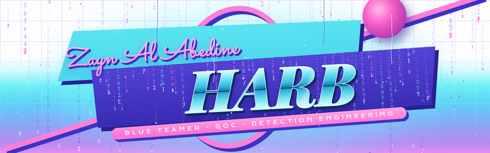

<p align="center"></p>

<p align="center">
  
  
  
</p>

```text
$ whoami
zayn al abedine harb  //  blue teamer

$ cat now.txt
▶ PLAY   M.Sc. Cybersecurity, BTU Cottbus-Senftenberg
         2 years on a 24/7 SOC floor: Sentinel, Defender XDR, FortiEDR, Wazuh, MISP
● REC    looking for Werkstudent / part-time / junior roles
         SOC · detection engineering · threat intelligence · incident response
         Germany, open to remote
```


| Tape | Project | What it does |
| :--- | :--- | :--- |
| `ZH-360` | [**wazuh-misp-integration**](https://github.com/64BitZayn/wazuh-misp-integration) | Sysmon events checked against MISP in real time; a hit raises a high-severity Wazuh alert |
| `ZH-480` | [**kql-hunting-library**](https://github.com/64BitZayn/kql-hunting-library) | Sentinel and Defender XDR hunting: compromised-credential sign-ins, email triage, IOC sweeps, IR playbook |
| `ZH-300` | [**misp-feed-event-recovery**](https://github.com/64BitZayn/misp-feed-event-recovery) | Pulls events from slow MISP feeds one UUID at a time |
| `ZH-120` | [**MAKS**](https://github.com/64BitZayn/MAKS) | Triages malware strings dumps for abused Windows APIs |
| `ZH-180` | [**FIM**](https://github.com/64BitZayn/FIM-File-Integrity-Manager) | PowerShell file integrity monitor with SHA-512 baselines |
| `ZH-420` | [**email-threat-analyzer**](https://github.com/64BitZayn/email-threat-analyzer) | Phishing triage tool. Closed source: demo and code on request |
| `ZH-240` | [**misp-synthwave-theme**](https://github.com/64BitZayn/misp-synthwave-theme) | Dark retrowave theme for MISP |
| `ZH-540` | [**multi-agent-job-application-pipeline**](https://github.com/64BitZayn/multi-agent-job-application-pipeline) | Multi-agent orchestration with review gates, failover and shared state |


`Detection engineering` &nbsp; `Threat hunting (KQL)` &nbsp; `Threat intelligence (MISP, OpenCTI)` &nbsp; `Incident response` &nbsp; `Malware analysis` &nbsp; `ICS/OT security (Modbus, DNP3, CIP)`


* Professional Cybersecurity Analyst, IBM
* Introduction to Cybersecurity, Cisco
* IT Security, Google
* Fundamentals of Network Security
* Foundations of Breach & Attack Simulation
* CCNA R&S: Introduction to Networks
* CCNA R&S: Routing and Switching
* Cybersecurity in IT and ICS Domains, CISA (US Cybersecurity and Infrastructure Security Agency)


<p align="center">
  <a href="https://www.linkedin.com/in/harbb"></a>
  <a href="https://64bitzayn.vercel.app/"></a>
  <a href="mailto:zaynspublicprofiles@gmail.com"></a>
</p>

<p align="center"><code>■ STOP &nbsp; thanks for watching &nbsp;·&nbsp; be kind, rewind</code></p>
